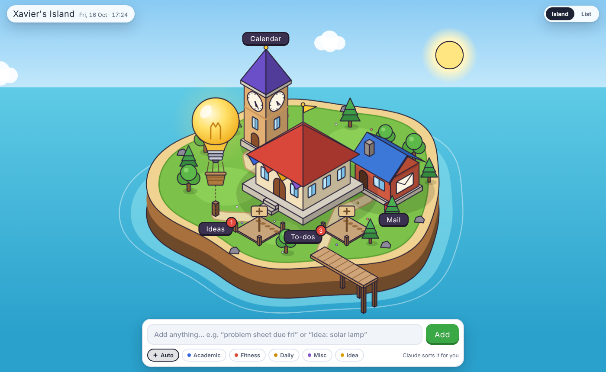

# Xavier's Island

A personal organiser you can explore as a little isometric island. Each building looks after one part of your life, and Claude runs in the background to sort what you add.

## Buildings

| Building | Job | Status |
|---|---|---|
| Town Hall | To-dos: Academic, Fitness, Daily and Misc | Working (v0.1) |
| Lightbulb Balloon | Ideas, with Claude suggesting next steps | Working (v0.1) |
| Clock Tower | Calendar: Outlook events and reminders | Preview, real clock hands |
| Post Office | Mail: Gmail and Outlook triage and summaries | Preview |
| Empty plots | Future buildings (Library, Arena…) | Planned |

## Design principles

1. **Capture in under 3 seconds.** A single quick-add bar is always on screen. You type naturally, e.g. "problem sheet due fri 9am", and it gets filed.
2. **The island is how you get around.** Every building is one tap away, and a List view is there for days when you just want to work.
3. **Calm by default.** No currencies or streak guilt. Day and night follow the real clock.

## How it works

- The app is hosted as a private Claude Artifact on claude.ai, so there are no servers and no API keys.
- Items are stored in the artifact's database, in a per-user private path (`data/users/<id>/island/items`).
- When you add something, keyword rules file it straight away. Claude (quick tier) then tidies up the title, category and date in the background.
- Everything is drawn in code. The isometric SVG is built from a small projection helper (`P(x, y, z)`) with box, pyramid and face primitives, and the buildings are depth-sorted.

## Roadmap

- [x] **Phase 1:** Town Hall to-dos, quick-add with Claude sorting, island mockup
- [ ] **Phase 2:** Island polish: building art pass, sounds (opt-in), onboarding
- [ ] **Phase 3:** Clock Tower connected to Outlook (Imperial + personal)
- [ ] **Phase 4:** Post Office with Gmail + Outlook, plus a scheduled morning digest
- [ ] **Phase 5:** Ideas balloon upgrades
- [ ] **Phase 6:** Slow, ambient island growth (months, not days)

See [DEVLOG.md](DEVLOG.md) for the build diary.
