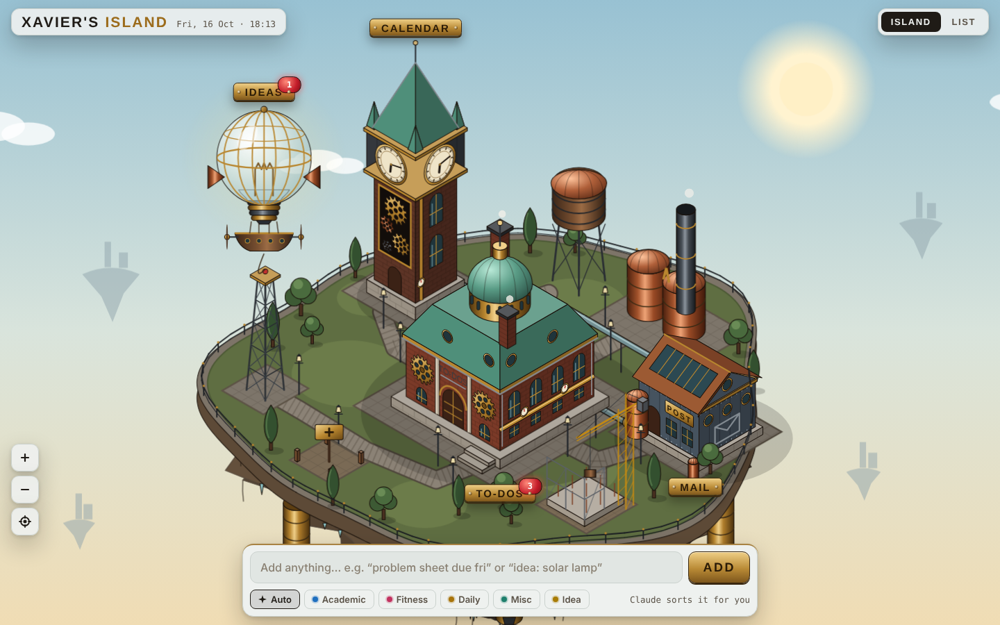
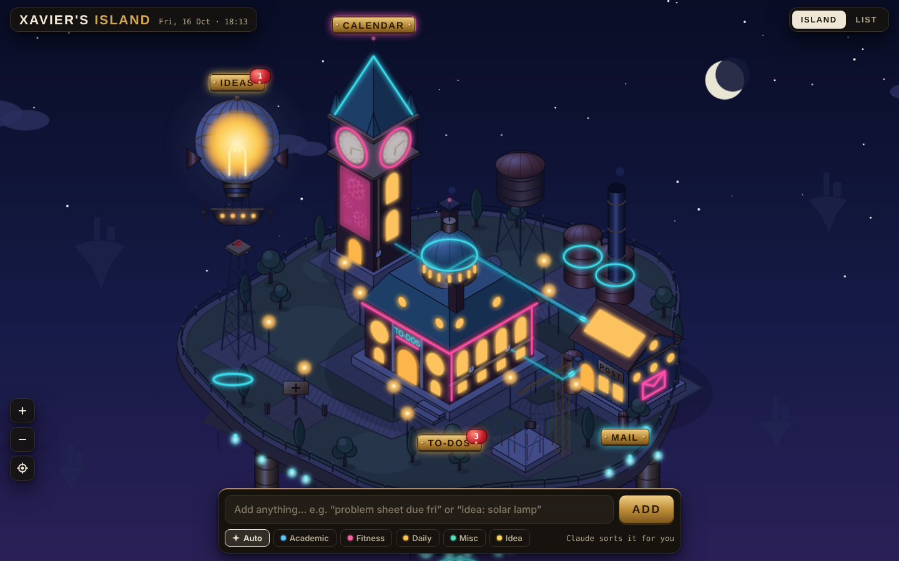

# Xavier's Island

A personal organiser built as a floating steampunk sky island. Each building looks after one part of your life, and Claude runs in the background to sort what you add. It's brass and steam by day; when the real clock hits dusk, the island switches to neon.

| Day | Night |
|---|---|
|  |  |

## Buildings

| Building | Job | Status |
|---|---|---|
| Guildhall | To-dos: Academic, Fitness, Daily and Misc | Working |
| Lightbulb Airship | Ideas, with Claude suggesting next steps | Working |
| Clock Tower | Calendar: Outlook events and reminders | Preview, real-time clock, live gear train |
| Pneumatic Post | Mail: Gmail and Outlook triage and summaries | Preview, capsules running through the tubes |
| Building site + empty plot | Future buildings (Library, Arena…) | Planned |

## Design principles

1. **Capture in under 3 seconds.** A single quick-add bar is always on screen. You type naturally, e.g. "problem sheet due fri 9am", and it gets filed.
2. **The island is how you get around.** Drag to pan, scroll or pinch to zoom, and tap a building or its brass plaque to open it. A List view is there for days when you just want to work.
3. **Calm by default.** No currencies or streak guilt. The day/night cycle follows the real clock.

## How it works

- The app is hosted as a private Claude Artifact on claude.ai, so there are no servers and no API keys.
- Items are stored in the artifact's database, in a per-user private path.
- When you add something, keyword rules file it straight away. Claude (quick tier) then tidies up the title, category and date in the background.
- **Everything is drawn in code:**
  - A small isometric engine projects world coordinates (`P(x, y, z)`) to the screen. Its primitives are boxes, pyramids, mansard frustums, cylinders and domes, plus "face groups" that let details (windows, gears, signs) be drawn flat onto any wall.
  - Brick, stone and riveted-panel textures are drawn procedurally. Metal finishes (brass, copper, iron, verdigris) are gradients.
  - Night mode applies a colour-matrix filter to the island, with a separate neon layer drawn on top through a glow filter.
  - The camera works by animating the SVG `viewBox`. The plaques are HTML, so they stay crisp at any zoom level.

## Roadmap

- [x] **v0.1:** Guildhall to-dos, quick-add with Claude sorting, first island mockup
- [x] **v0.2:** Full art redraw (steampunk + neon), bigger spread-out island, pan & zoom
- [ ] **v0.3:** Clock Tower connected to Outlook (Imperial + personal)
- [ ] **v0.4:** Pneumatic Post with Gmail + Outlook, plus a scheduled morning digest
- [ ] **v0.5:** Airship upgrades for ideas
- [ ] **v0.6:** Slow, ambient island growth (months, not days)

See [DEVLOG.md](DEVLOG.md) for the build diary.
