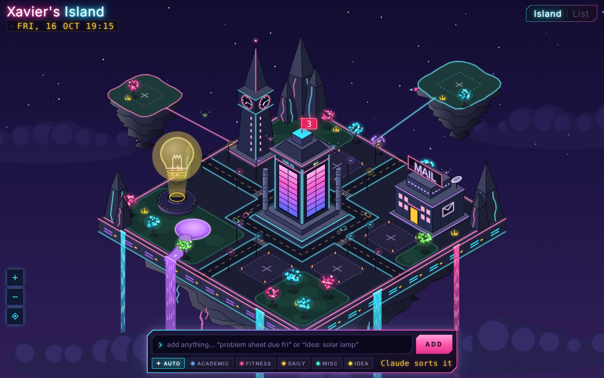

# Xavier's Island

A personal organiser built as a floating neon sky-island. Each building looks after one part of your life, there are empty plots and expansion islets to grow into, and Claude runs in the background to sort what you add.

## Buildings

| Building | Job | Status |
|---|---|---|
| Task HQ | To-dos: Academic, Fitness, Daily and Misc | Working |
| Idea Beacon | Ideas (a hologram lightbulb), with Claude suggesting next steps | Working |
| Chrono Spire | Calendar: Outlook events and reminders | Preview, real-time neon clock |
| Data Post | Mail: Gmail and Outlook triage and summaries | Preview, with a delivery drone |
| Blaugrana Stadium | FC Barcelona: fixtures, results, live scoreboard, Sofascore-style stats | Working, refreshed hourly 12:00–23:00 |
| 4 empty plots + 2 expansion islets | Room for future buildings | Planned |

## Design principles

1. **Capture in under 3 seconds.** A single quick-add bar is always on screen. You type naturally, e.g. "problem sheet due fri 9am", and it gets filed.
2. **The island is how you get around.** Drag to pan, scroll or pinch to zoom, and tap a building to open it. A List view is there for days when you just want to work.
3. **Quiet until you need it.** Name tags only appear when you hover over a building. The only thing always on screen is a small count of to-dos due today or overdue.
4. **Room to grow.** There are empty plots on the island and two expansion islets behind it.

## How it works

- The app is hosted as a private Claude Artifact on claude.ai, so there are no servers and no API keys.
- Items are stored in the artifact's database, in a per-user private path.
- When you add something, keyword rules file it straight away. Claude (quick tier) then tidies up the title, category and date in the background.
- **Everything is drawn in code:**
  - A small isometric engine projects world coordinates (`P(x, y, z)`) to the screen, with "face groups" for drawing details flat onto walls and floors.
  - The surrounding city is generated procedurally from a seeded random number generator: towers, window rows, neon blade signs, billboards, and traffic on the street below.
  - Neon is drawn as layered strokes (a wide halo, a body and a hot core) instead of SVG blur filters. This is faster, and because each light is drawn where it sits in the paint order, buildings in front correctly cover it.
  - The camera works by animating the SVG `viewBox`. The tags are HTML, so they stay crisp at any zoom level.

## Roadmap

- [x] **v0.1:** Town Hall to-dos, quick-add with Claude sorting, first island mockup
- [x] **v0.2:** Steampunk sky island, neon at night, pan & zoom
- [x] **v0.3:** Neon city platform, room to grow, hover tags
- [x] **v0.4:** Whimsical pass: round towers, domes, string lights, fountain, kiosks
- [x] **v0.5:** Floating neon sky-island, light waterfalls, in-world neon UI
- [x] **v0.6:** Blaugrana Stadium: FC Barcelona matches, live scoreboard and stats
- [x] **v0.6.2:** Input overhaul: trackpad pan/pinch, reliable clicks, 2× smoother
- [x] **v0.6.3:** Gesture polish: no hover flicker while panning, no stuck clicks
- [x] **v0.7:** La Roja islet (Spain), Champions League stats, daily + match-time refresh
- [x] **v0.8:** Morning Dispatch, News Tower, Studio, Habit Garden, Coursework, Focus Lighthouse + Sunday review
- [ ] **v0.9:** Chrono Spire connected to Outlook (Imperial + personal)
- [ ] **v1.0:** Data Post with Gmail + Outlook, folded into the Morning Dispatch
- [ ] **Later:** iPhone shortcut for quick add
- [ ] **Later:** slow, ambient growth (months, not days)

See [DEVLOG.md](DEVLOG.md) for the build diary.
